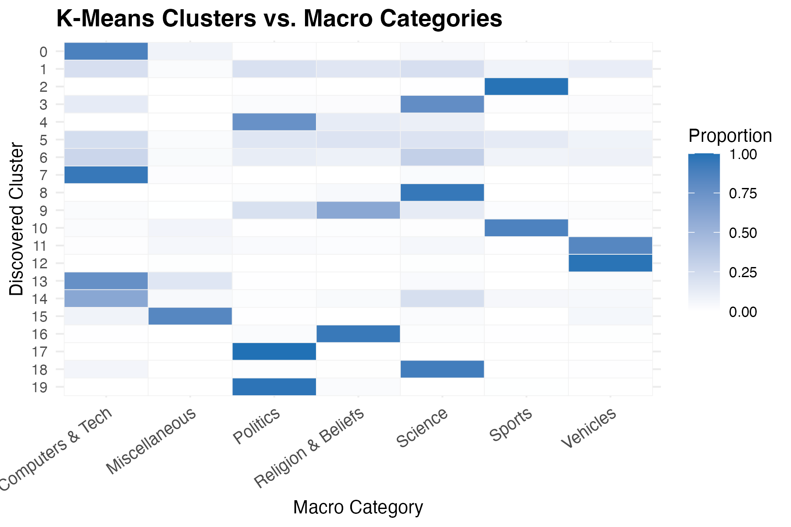

<a class="grid-item" data-featured="false" data-tags="r,python" href="https://diverse-data-hub.github.io/website_files/description_pages/twentynewsgroups.html">
  
  <h3>20 Newsgroups</h3>
  

    This dataset contains approximately 20,000 Usenet discussion posts organized into 20 newsgroups, covering topics such as computer hardware, science, politics, religion, and sports. It is useful for exploring text preprocessing, classifying posts by topic using Naive Bayes, and discovering thematic patterns through K-Means clustering.
  

</a>
